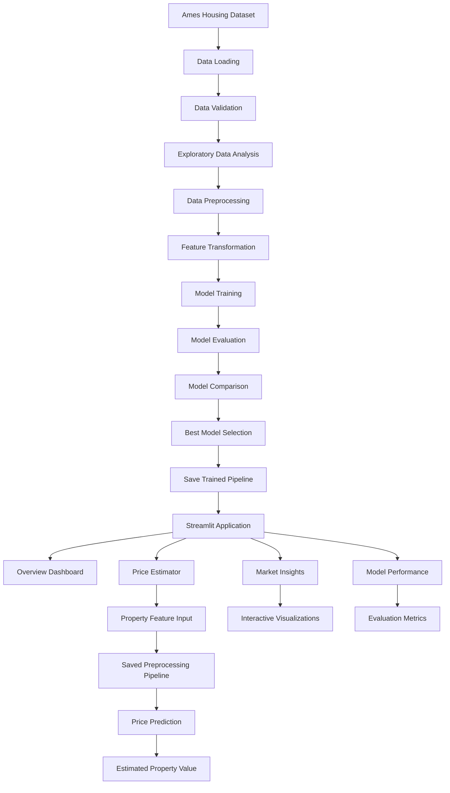

# Estatiq Property Intelligence

An end-to-end machine learning project for residential house price prediction using the Ames Housing Dataset. The project combines data analysis, regression modeling, model evaluation, and an interactive Streamlit dashboard to estimate property values based on their characteristics.

Estatiq provides an intuitive property intelligence platform where users can explore housing market patterns, configure property details, generate price predictions, and review machine learning model performance.

---

## Project Overview

Residential property prices depend on several factors, including location, construction quality, living area, number of bedrooms and bathrooms, garage capacity, and basement size.

This project uses machine learning to identify patterns in historical housing data and predict the estimated sale price of a property based on its characteristics.

The application provides four main modules:

- **Overview:** Displays dataset statistics and housing price visualizations.
- **Price Estimator:** Generates price estimates using a saved machine learning pipeline.
- **Market Insights:** Explores property prices, living areas, and neighborhood-level trends.
- **Model Performance:** Displays model comparison results and evaluation metrics.

### Project Workflow

**Dataset → Data Validation → Preprocessing Pipeline → Model Training → Model Evaluation → Best Model Selection → Price Prediction → Interactive Dashboard**

---

## Objectives

- Analyze residential housing data using Python.
- Explore relationships between property characteristics and sale prices.
- Process numerical and categorical features.
- Develop and evaluate machine learning regression models.
- Compare model performance using appropriate regression metrics.
- Save and reuse the trained machine learning pipeline.
- Predict house prices for user-configured properties.
- Visualize housing price distributions and neighborhood trends.
- Build a professional, interactive dashboard using Streamlit.
- Provide a downloadable version of the housing dataset.

---

## System Architecture



---

## Dataset

The project uses the **Ames Housing Dataset**, which contains residential property characteristics and their corresponding sale prices.

The application reads the training dataset from:

```text
data/train.csv
```

### Target Variable

| Variable | Description |
|---|---|
| `SalePrice` | Recorded sale price of the property |

The `SalePrice` column is used to analyze historical prices and calculate dataset statistics. The trained model predicts this target variable.

### Important Features

The application automatically identifies commonly used housing features when they are available in the dataset.

| Feature | Description |
|---|---|
| `Overall Qual` | Overall material and finish quality |
| `Gr Liv Area` | Above-ground living area in square feet |
| `Bedroom AbvGr` | Number of bedrooms above ground |
| `Full Bath` | Number of full bathrooms |
| `Garage Cars` | Garage vehicle capacity |
| `Year Built` | Original construction year |
| `Neighborhood` | Neighborhood or property location |
| `Total Bsmt SF` | Total basement area |
| `Lot Area` | Total lot size |

The saved model may use additional features beyond those displayed in the estimator form.

---

## Application Modules

### 1. Overview Dashboard

The overview page provides a summary of the housing dataset and its characteristics.

**Key features:**

- Total number of valid property records.
- Median recorded sale price.
- Average recorded sale price.
- Number of features used by the saved model.
- Sale price distribution histogram.
- Property quality versus sale price box plot.
- Navigation shortcuts to other modules.
- Dataset and model loading status.

The statistics are calculated from the available dataset rather than entered manually.

### 2. Price Estimator

The Price Estimator allows users to configure property characteristics and generate a machine learning-based price prediction.

**User-configurable inputs include:**

- Overall property quality.
- Living area.
- Number of bedrooms.
- Number of full bathrooms.
- Garage capacity.
- Year built.
- Neighborhood.
- Basement area.
- Lot area.

The application initializes all expected model features using representative values from the dataset. When the user changes the available property inputs, the corresponding feature values are updated before prediction.

The resulting input is passed to the saved preprocessing and prediction pipeline.

**Output includes:**

- Estimated property value.
- Difference between the estimate and the dataset median.
- Number of features supplied to the model.
- Reference median sale price.

The estimate is intended for educational analysis and is not a formal property appraisal or a guaranteed market selling price.

### 3. Market Insights

This module explores patterns in the recorded housing data.

**Visualizations include:**

- Living area versus sale price scatter plot.
- Neighborhood-wise median sale price comparison.
- Lowest recorded sale price.
- Highest recorded sale price.
- Overall median sale price.
- Preview of the housing dataset.
- Download option for the cleaned dataset in CSV format.

These visualizations help users investigate relationships between property characteristics and historical sale prices.

### 4. Model Performance

The Model Performance module displays evaluation results produced by the model training workflow.

It reads the model comparison file from:

```text
results/model_comparison.csv
```

When the file is available, the dashboard displays:

- Model comparison results.
- Selectable evaluation metrics.
- Interactive model performance bar charts.
- Evaluation guidance for MAE, RMSE, and R².

If the comparison file is unavailable, the dashboard displays a message asking the user to run model training.

---

## Machine Learning Workflow

### Data Loading and Validation

Pandas is used to load the dataset. The application checks whether the dataset and trained model exist before proceeding.

It also validates that the dataset contains the required target column and that the original feature columns expected by the saved model are present.

### Data Preprocessing

The saved machine learning pipeline contains a preprocessing step that prepares the input features for prediction.

Depending on the training pipeline configuration, preprocessing may include:

- Missing-value imputation.
- Numerical feature transformation.
- Categorical feature encoding.
- Feature selection or transformation.

The exact preprocessing operations depend on the implementation in the model training script.

### Model Training

Regression models are trained to estimate residential property sale prices.

The training process should evaluate candidate models using a consistent training and testing strategy before selecting the final model.

### Model Selection

The selected model is saved as a serialized pipeline:

```text
models/best_model.joblib
```

The Streamlit application loads this saved pipeline and uses it for predictions. Model algorithms and their performance should be documented using the actual training results.

### Price Prediction

The application constructs a DataFrame containing the original feature columns expected by the model.

The saved pipeline transforms the input and generates the estimated sale price:

```python
input_df = pd.DataFrame(
    [[input_values[col] for col in feature_columns]],
    columns=feature_columns,
)

prediction = float(model.predict(input_df)[0])
```

This approach allows the prediction stage to reuse the preprocessing and modeling steps saved during training.

---

## Model Evaluation

House price prediction is a regression problem. Therefore, regression evaluation metrics are more appropriate than classification accuracy.

### Mean Absolute Error (MAE)

MAE measures the average absolute difference between actual and predicted property prices.

Lower MAE indicates smaller average prediction errors.

### Root Mean Squared Error (RMSE)

RMSE measures prediction errors while penalizing larger errors more strongly.

Lower RMSE generally indicates better predictive performance.

### R² Score

R² measures how much of the variation in the target variable is explained by the regression model.

Higher R² generally indicates better performance, although it should be interpreted alongside other metrics and the evaluation dataset.

### Model Comparison

Actual evaluation results can be displayed in the dashboard using:

```text
results/model_comparison.csv
```

| Metric | Preferred Direction |
|---|---|
| MAE | Lower |
| RMSE | Lower |
| R² Score | Higher |

Model names, evaluation metrics, and numerical results should be taken from the actual model training experiments.

---

## Technologies Used

### Programming Language
- Python

### Data Processing
- Pandas

### Machine Learning
- Scikit-learn
- Joblib

### Data Visualization
- Plotly Express

### Dashboard Development
- Streamlit

### Development Tools
- Visual Studio Code
- Git
- GitHub
- Python virtual environment

---

## Project Structure

The following structure reflects the files referenced by the current Streamlit application. Additional training scripts and analysis notebooks can be included according to the actual repository implementation.

```text
House-Price-Prediction-ML/
│
├── app.py
│
├── data/
│   └── train.csv
│
├── src/
│   └── train_model.py
│
├── models/
│   └── best_model.joblib
│
├── results/
│   └── model_comparison.csv
│
├── requirements.txt
├── README.md
└── .gitignore
```

**Note:** If your Streamlit code is stored in a different filename, replace `app.py` with the actual filename. The `train_model.py` script should create the saved model and, if implemented, the model comparison CSV.

---

## Installation

### Prerequisites

Install the following before running the project:

- Python 3.10 or later, subject to dependency compatibility.
- pip package manager.
- Git.
- Visual Studio Code or another Python editor.

### Step 1: Clone the Repository

```bash
git clone https://github.com/gamana29/House-Price-Prediction-ML.git
```

### Step 2: Navigate to the Project Directory

```bash
cd House-Price-Prediction-ML
```

### Step 3: Create a Virtual Environment

On Windows:

```powershell
python -m venv .venv
```

Activate the environment:

```powershell
.venv\Scripts\activate
```

### Step 4: Install Dependencies

```bash
python -m pip install --upgrade pip
pip install -r requirements.txt
```

Ensure that `requirements.txt` includes the libraries used by the application and the model training pipeline.

Typical dashboard dependencies include:

```text
pandas
scikit-learn
joblib
plotly
streamlit
```

Add any other libraries required by your actual training script.

---

## Running the Project

### Step 1: Prepare the Dataset

Place the Ames housing training dataset at:

```text
data/train.csv
```

Verify that it contains the `SalePrice` target column and the feature columns expected by the trained pipeline.

### Step 2: Train the Model

If the saved model does not exist, run the training script:

```powershell
python .\src\train_model.py
```

The script should generate the trained model at:

```text
models/best_model.joblib
```

If model comparison is implemented, it should also generate:

```text
results/model_comparison.csv
```

The exact output files depend on the implementation of `src/train_model.py`.

### Step 3: Launch the Streamlit Dashboard

If the application code is saved as `app.py`, run:

```bash
streamlit run app.py
```

If your file has a different name, use that filename instead.

### Step 4: Explore the Application

Once the application starts, open the local URL displayed in the terminal.

Navigate between the four available modules:

1. Overview
2. Price Estimator
3. Market Insights
4. Model Performance

Configure a property in the estimator and submit the form to generate a prediction.

---

## Key Features

- End-to-end house price prediction workflow.
- Reusable machine learning preprocessing pipeline.
- Interactive property valuation form.
- Dataset-driven price statistics.
- Housing price distribution visualization.
- Quality-based sale price analysis.
- Neighborhood-level price comparison.
- Model evaluation and comparison dashboard.
- CSV dataset download.
- Custom dark-themed user interface.
- Input validation and missing-file handling.
- Caching for efficient data and model loading.

---

## Future Improvements

Potential enhancements for future versions include:

- More advanced feature engineering.
- Systematic cross-validation and hyperparameter tuning.
- Feature importance analysis.
- SHAP-based explainable AI.
- Actual versus predicted price plots.
- Residual and prediction error analysis.
- Prediction intervals to communicate uncertainty.
- Improved validation of user inputs.
- REST API for external prediction requests.
- Cloud deployment.
- Automated model retraining and monitoring.
- Integration with verified, current property listing data.

---

## Limitations

- Predictions depend on the quality and coverage of the training dataset.
- The dataset median is a reference statistic, not a live market benchmark.
- The application does not fetch current property listings or real-time market prices.
- The saved model may rely on additional features that are not directly editable through the dashboard.
- Predictions may be less reliable for properties that differ significantly from the training data.
- The accuracy of the system must be assessed using actual held-out evaluation results.


---

*Estatiq Property Intelligence — Turning housing data into data-driven property insights.*
